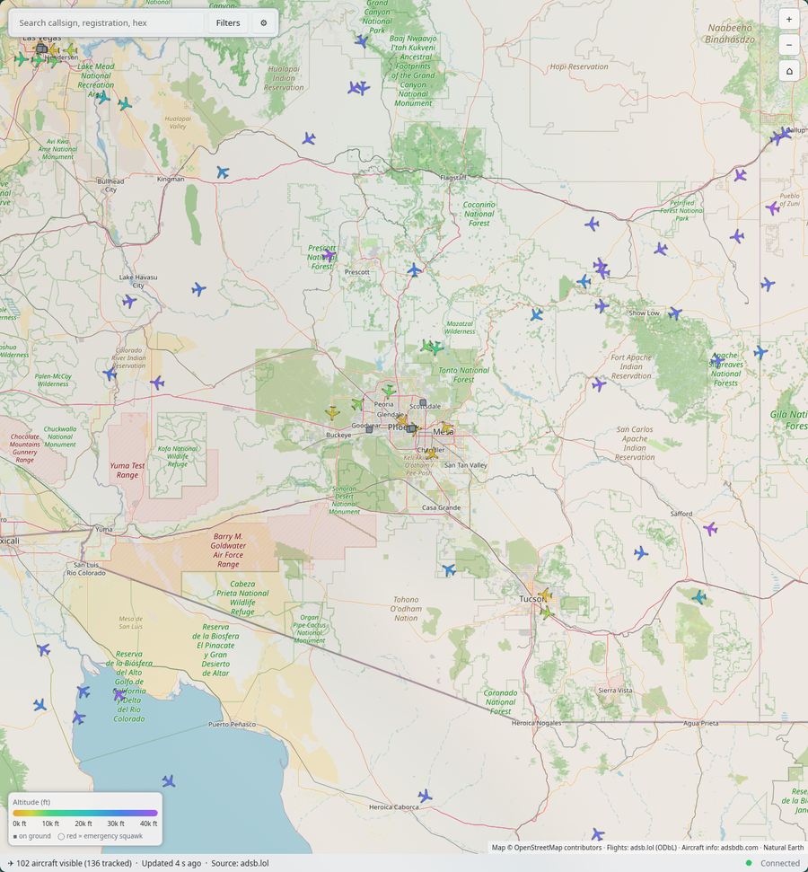
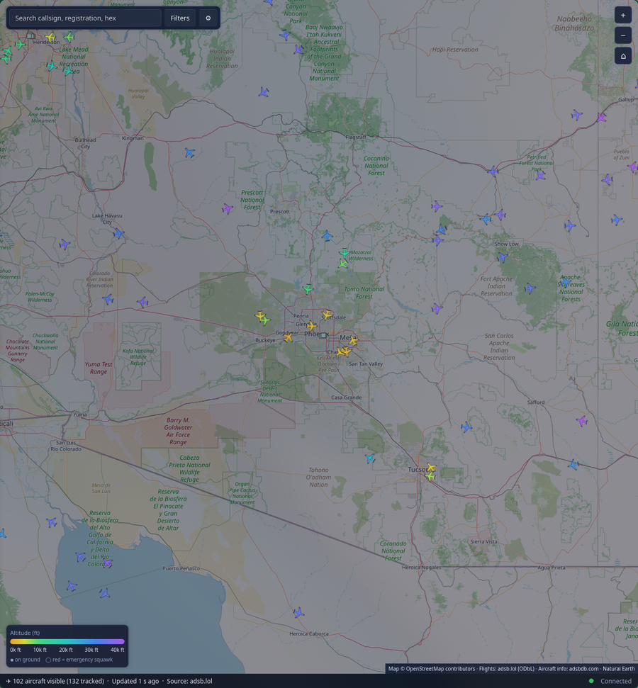

# skytrace

[](https://github.com/legendarylolo318-cloud/skytrace/actions/workflows/ci.yml)
[](https://github.com/legendarylolo318-cloud/skytrace/releases/latest)

A lightweight desktop live flight tracker written in Rust with a [Slint](https://slint.dev) UI.
Free data sources only, no API keys required.

> **Non-commercial use.** skytrace relies on community and research data services
> (adsb.lol, adsb.fi, OpenSky, adsbdb, OpenStreetMap tile servers) whose terms
> restrict or discourage commercial use. Use it as a personal / hobby tool.

## Download

Prebuilt binaries are attached to each [GitHub Release](https://github.com/legendarylolo318-cloud/skytrace/releases/latest):

| Platform | File |
|---|---|
| Linux x86_64 | [`skytrace-x86_64.AppImage`](https://github.com/legendarylolo318-cloud/skytrace/releases/latest/download/skytrace-x86_64.AppImage) |
| Windows x86_64 | [`skytrace-windows-x86_64.exe`](https://github.com/legendarylolo318-cloud/skytrace/releases/latest/download/skytrace-windows-x86_64.exe) |

`SHA256SUMS.txt` is published alongside them.

```bash
chmod +x skytrace-x86_64.AppImage
./skytrace-x86_64.AppImage
```

The Windows build is a portable, unsigned `.exe` (no installer, no console window). SmartScreen
may ask for confirmation on first start.

## Screenshots



<details>
<summary>Midnight theme</summary>


</details>

## Features

- Slippy map: drag to pan, scroll wheel (zoom-to-cursor) and +/− buttons, configurable tile URL.
  Tiles are cached on disk (7-day expiry, files unused for 30 days are pruned) and in an LRU memory
  cache. At most 2 concurrent tile connections, and only visible tiles are requested (no prefetching).
- Offline fallback basemap (bundled Natural Earth 110m coastlines and borders) drawn under the tiles.
- Live aircraft from **adsb.lol**, with automatic failover to **adsb.fi** (and optionally **OpenSky**),
  behind a `FlightSource` trait. Each source has its own exponential backoff and honours
  `Retry-After` / `X-Rate-Limit-Retry-After-Seconds`.
- Only the visible map area (plus a 10 nm margin) is queried (centre + radius, max 250 nm; OpenSky
  uses the bounding box). An empty area says so in the status bar instead of showing a blank map.
  Default poll every 5 s, minimum 2 s. Per-source request spacing is enforced (adsb.fi ≤ 1 req/s,
  OpenSky ≥ 30 s apart to stay within its anonymous credit budget).
- Dead reckoning (track + ground speed, including the age of each position) between polls.
- Plane icons rotated to track/heading and coloured by altitude (legend included), a separate
  on-ground marker, and a red highlight + banner for squawks 7500/7600/7700.
- Hover shows the callsign. Click opens a side panel with callsign, registration, hex, type,
  operator, route, baro/geometric altitude, speed, vertical rate, heading, squawk, position,
  last seen and source. The panel also shows the session trail and has a *Follow* toggle.
  Registration/type/operator/route come lazily from adsbdb.com and are cached in memory and on disk
  (bounded, with TTLs).
- Search (callsign / registration / hex; Enter jumps to the first match), filters (altitude range,
  hide ground, military only, aircraft type) and a stats bar.
- Themes: System, Light, Dark, Midnight, Sepia, High contrast. Imperial / metric units.
  Settings are persisted to the platform config dir.

## Configuration

Settings are stored as TOML in the platform config directory (`~/.config/skytrace/config.toml` on
Linux, `%APPDATA%\skytrace\config\config.toml` on Windows) and edited through the ⚙ dialog. A missing
or corrupt file falls back to defaults. The default home is Phoenix, AZ. Caches live in the platform
cache directory (`~/.cache/skytrace`, `%LOCALAPPDATA%\skytrace\cache`).

## Build from source

Rust 1.88+ (edition 2024) is required. TLS uses rustls with `ring`, so no OpenSSL is needed.

### Arch Linux

```bash
sudo pacman -S --needed rust base-devel pkgconf fontconfig freetype2 libxkbcommon wayland libx11 libxcursor libxi libxrandr mesa
git clone https://github.com/legendarylolo318-cloud/skytrace.git
cd skytrace
cargo build --release
./target/release/skytrace
```

(`rustup` from the Arch repos works as well as the `rust` package.)

### Windows

1. Install [Visual Studio Build Tools](https://visualstudio.microsoft.com/visual-cpp-build-tools/)
   with the *Desktop development with C++* workload (MSVC + Windows SDK).
2. Install Rust via [rustup](https://rustup.rs) (default `x86_64-pc-windows-msvc` toolchain).
3. Build:

```powershell
git clone https://github.com/legendarylolo318-cloud/skytrace.git
cd skytrace
cargo build --release
.\target\release\skytrace.exe
```

Release builds use the GUI subsystem (no console window) and embed `packaging/skytrace.ico`.

### AppImage (Linux)

```bash
cargo build --release
curl -fsSLO https://github.com/linuxdeploy/linuxdeploy/releases/download/continuous/linuxdeploy-x86_64.AppImage
chmod +x linuxdeploy-x86_64.AppImage
./linuxdeploy-x86_64.AppImage --appdir AppDir --executable target/release/skytrace \
  --desktop-file packaging/skytrace.desktop --icon-file packaging/skytrace.png --output appimage
```

### Checks

```bash
cargo fmt --check
cargo clippy --all-targets -- -D warnings
cargo test
```

The test suite includes a headless end-to-end UI test (Slint testing backend) covering plane
loading, click → detail panel, search, filters, settings persistence, themes and fallback reporting.

## Data sources and attribution

The map always shows the required credits in its bottom-right corner.

- Flight positions: [adsb.lol](https://adsb.lol), data licensed under the
  [**ODbL**](https://opendatacommons.org/licenses/odbl/) (Open Database License).
  Fallback: [adsb.fi](https://adsb.fi) open data (personal, non-commercial use; 1 request/s).
  Optional: [The OpenSky Network](https://opensky-network.org) (off by default, non-commercial,
  anonymous credit-limited).
- Aircraft/route metadata: [adsbdb.com](https://www.adsbdb.com).
- Map tiles: © [OpenStreetMap](https://www.openstreetmap.org/copyright) contributors, map data
  under the ODbL. Tiles are used under the
  [OSM tile usage policy](https://operations.osmfoundation.org/policies/tiles/), with an identifying
  User-Agent, a disk cache and no bulk prefetching. For heavy use, configure another tile provider.
- Offline basemap: [Natural Earth](https://www.naturalearthdata.com) (public domain).

skytrace previously used airplanes.live as its fallback. airplanes.live has since closed its REST
API to the public (non-feeders get HTTP 403), so it was replaced by adsb.fi. Old configs that select
`airplanes_live` load as adsb.fi.

## Layout

```
src/config   settings load/save
src/model    aircraft, filters, geometry/dead reckoning, metadata types
src/sources  FlightSource trait, adsb.lol/adsb.fi/OpenSky, failover manager, poller, adsbdb
src/map      Web Mercator projection, tile fetch/cache, Natural Earth basemap
src/ui       Slint wiring (app.rs), formatting; ui/main.slint is the view
packaging    .desktop file and icons (AppImage / Windows)
```

## License

[MIT](LICENSE) © 2026 skytrace contributors.
